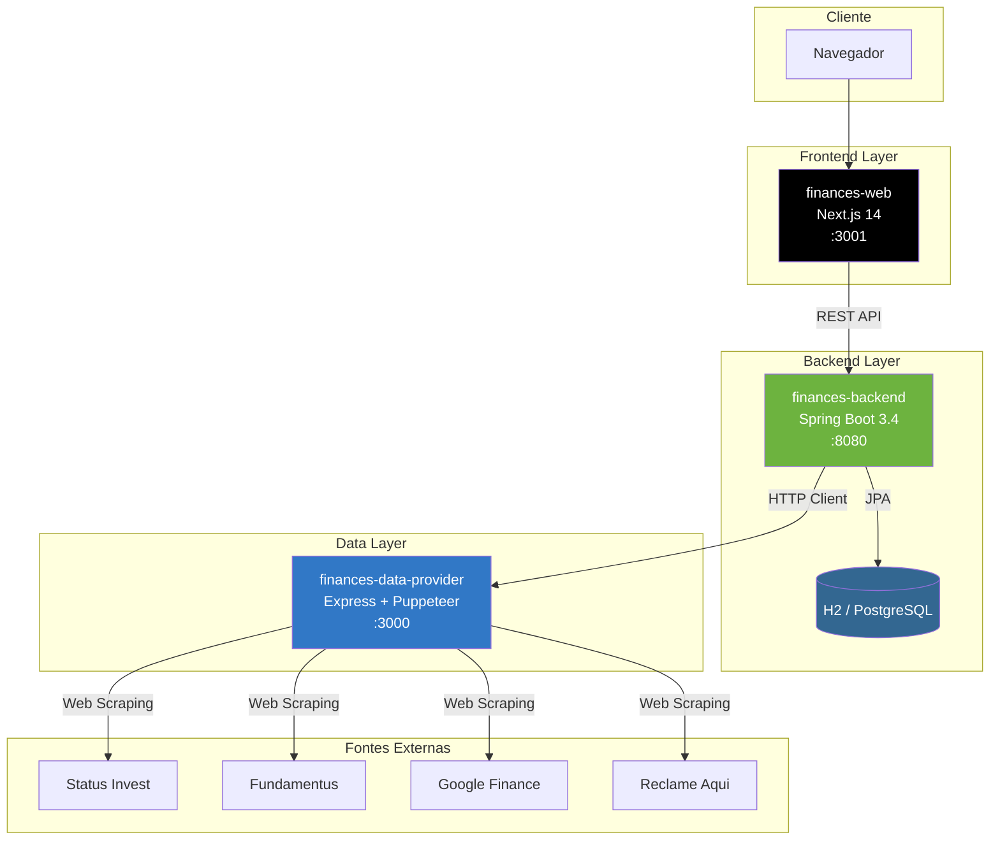
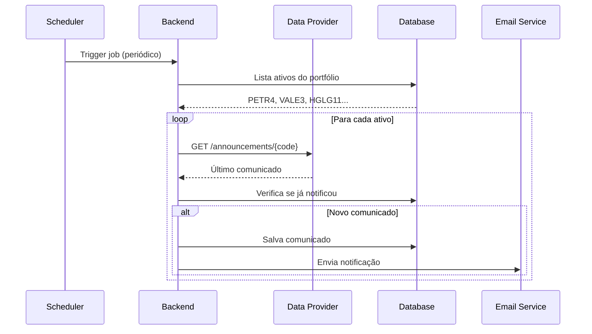
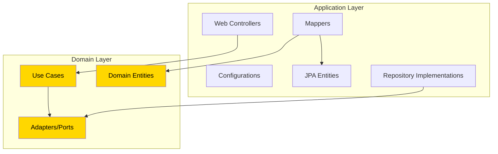
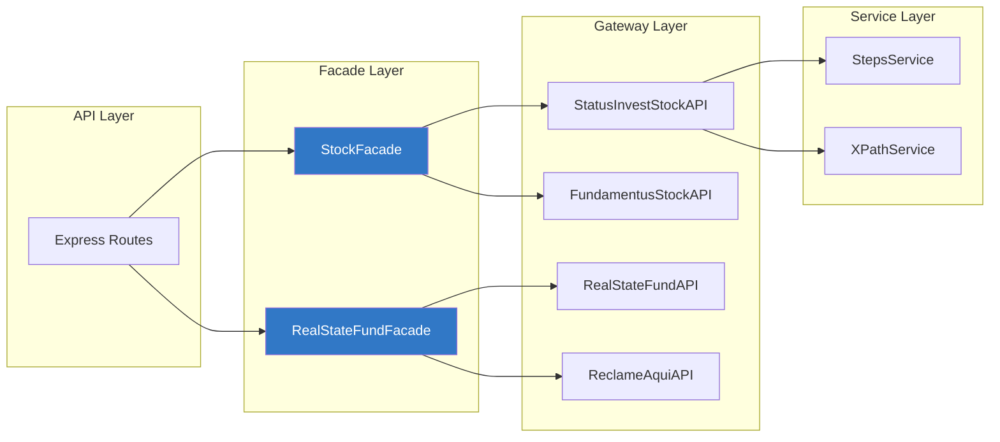

# Arquitetura

Esta página descreve a arquitetura geral do sistema Finances, incluindo a comunicação entre módulos, padrões utilizados e estrutura interna de cada componente.

## Visão Geral

O Finances segue uma arquitetura de **microsserviços simplificada**, onde cada módulo tem responsabilidades bem definidas:



## Fluxo de Dados

### Consulta de Dados de Ativos

```mermaid
sequenceDiagram
    participant U as Usuário
    participant W as Web (Next.js)
    participant B as Backend (Spring)
    participant P as Data Provider
    participant S as Status Invest

    U->>W: Solicita dados do ativo PETR4
    W->>B: GET /api/assets/PETR4
    B->>P: GET /stock/PETR4
    P->>S: Scraping da página
    S-->>P: HTML com dados
    P-->>B: JSON com indicadores
    B-->>W: Dados processados
    W-->>U: Exibe dashboard
```



### Notificação de Comunicados



## Arquitetura do Backend

O módulo `finances-backend` segue os princípios da **Clean Architecture** adaptada para Spring Boot:



### Estrutura de Pacotes

```
br.com.gabreuw.finances/
├── announcement_search_engine/    # Motor de busca de comunicados
│   ├── application/
│   │   ├── config/               # Beans e configurações
│   │   ├── database/             # Entidades JPA e repositórios
│   │   ├── mapper/               # Conversão domain ↔ entity
│   │   ├── provider/             # Integração com Data Provider
│   │   └── web/                  # DTOs de API
│   └── domain/
│       ├── adapters/             # Interfaces (ports)
│       ├── entities/             # Entidades de domínio
│       ├── errors/               # Exceções de negócio
│       └── usecases/             # Casos de uso
├── asset_analyzer/               # Análise de ativos
├── bank_account/                 # Gestão de contas bancárias
├── interest/                     # Cálculos de juros
├── investment_portfolio/         # Portfólio de investimentos
├── transactions/                 # Transações
│   ├── fixed/income/            # Renda fixa
│   └── variable/income/         # Renda variável
└── shared/                       # Utilitários compartilhados
    ├── errors/                   # Exceções base
    ├── helper/                   # Classes auxiliares
    ├── logging/                  # Configuração de logs
    ├── pagination/               # Paginação
    ├── usecase/                  # Interface base UseCase
    └── validation/               # Self-validation
```

### Padrão UseCase

Todos os casos de uso seguem uma interface padronizada:

```java
public interface UseCase<I extends InputValues, O extends OutputValues> {
    O execute(I input);
    
    interface InputValues {}
    interface OutputValues {}
}
```

**Exemplo de implementação:**

```java
@Component
public record NotifyLastAnnouncementUseCase(
        AnnouncementProvider announcementProvider,
        AnnouncementRepository announcementRepository
) implements UseCase<InputValues, OutputValues> {

    @Override
    public OutputValues execute(InputValues input) {
        var announcement = announcementProvider.getLastAnnouncement(input.assetCode());
        announcementRepository.save(announcement);
        return new OutputValues(announcement);
    }

    public record InputValues(String assetCode) implements UseCase.InputValues {}
    public record OutputValues(Announcement announcement) implements UseCase.OutputValues {}
}
```

## Arquitetura do Data Provider

O módulo `finances-data-provider` utiliza o padrão **Facade** para simplificar a integração com múltiplas fontes:



### Estrutura de Diretórios

```
src/
├── domain/
│   ├── adapters/                 # Interfaces base (DTO)
│   └── types/                    # Tipos TypeScript
├── gateways/
│   ├── google/                   # Google Finance API
│   └── status_invest/            # Status Invest scraper
├── stocks/
│   ├── facade/                   # StockFacade
│   ├── gateway/                  # APIs de ações
│   └── service/                  # Steps e XPath services
├── real-state-fund/
│   ├── facade/                   # RealStateFundFacade
│   ├── gateway/                  # APIs de FIIs
│   └── services/                 # Steps e XPath services
├── reclame-aqui/                 # Scraper do Reclame Aqui
├── announcement-search-engine/   # Busca de comunicados
├── shared/
│   ├── errors/                   # Classes de erro
│   ├── helpers/                  # Funções utilitárias
│   ├── validation/               # Validação com Zod
│   └── web/                      # HTTP status codes
├── routes.ts                     # Definição de rotas
└── server.ts                     # Entry point
```

## Padrões e Boas Práticas

### Backend

| Padrão | Uso |
|--------|-----|
| **Clean Architecture** | Separação entre domain e application layers |
| **Repository Pattern** | Abstração do acesso a dados |
| **Use Case Pattern** | Encapsulamento de regras de negócio |
| **Self-Validation** | Entidades validam a si mesmas na construção |
| **Record Classes** | DTOs e Value Objects imutáveis (Java 17+) |

### Data Provider

| Padrão | Uso |
|--------|-----|
| **Facade Pattern** | Simplifica integração com múltiplas fontes |
| **Gateway Pattern** | Encapsula comunicação com APIs externas |
| **Strategy Pattern** | Diferentes estratégias de scraping por fonte |
| **DTO Pattern** | Tipagem forte dos dados extraídos |

---

## Comunicação entre Módulos

```mermaid
graph LR
    subgraph "Backend :8080"
        FDP[FinancesDataProvider]
    end

    subgraph "Data Provider :3000"
        RT[/announcements/:code]
        RSF[/real-state-fund/:code]
        STK[/stock/:code]
        CP[/currentPrice/:code]
    end

    FDP --> |HTTP GET| RT
    FDP --> |HTTP GET| RSF
    FDP --> |HTTP GET| STK
    FDP --> |HTTP GET| CP

    style FDP fill:#6DB33F,color:#fff
```

**Configuração no Backend (`application-dev.yaml`):**

```yaml
finances-data-provider:
  base-url: http://localhost:3000
  endpoints:
    announcements: ${finances-data-provider.base-url}/announcements
    real-state-fund: ${finances-data-provider.base-url}/real-state-fund
    stock: ${finances-data-provider.base-url}/stock
```

---

## Próximos Passos

- [Voltar para Home](./Home.md)
- [Início Rápido](./Getting-Started.md)
- [Backend Module](./Backend-Module.md)
