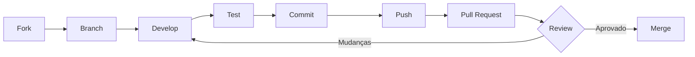

# Contribuindo

## Código de Conduta

Ao contribuir com este projeto, você concorda em respeitar nosso Código de Conduta:

- Seja respeitoso e inclusivo
- Use linguagem acolhedora
- Foque no que é melhor para a comunidade
- Aceite críticas construtivas com gratidão

## Reportando Bugs

Encontrou um bug? Ajude-nos a corrigi-lo!

### Antes de Reportar

1. Verifique se o bug já não foi reportado nas [Issues](https://github.com/ImGabreuw/finances/issues)
2. Certifique-se de estar usando a versão mais recente
3. Tente reproduzir o bug em um ambiente limpo

### Como Reportar

Abra uma [nova issue](https://github.com/ImGabreuw/finances/issues/new) com:

```markdown
## Descrição do Bug
Descrição clara e concisa do problema.

## Passos para Reproduzir
1. Vá para '...'
2. Clique em '...'
3. Role até '...'
4. Veja o erro

## Comportamento Esperado
O que você esperava que acontecesse.

## Screenshots
Se aplicável, adicione screenshots.

## Ambiente
- OS: [ex: Ubuntu 22.04]
- Node.js: [ex: 18.17.0]
- Java: [ex: 17.0.8]
- Browser: [ex: Chrome 120]

## Contexto Adicional
Qualquer informação relevante.
```

## Propondo Novas Features

Tem uma ideia? Adoramos novas ideias!

### Processo

1. **Verifique as issues existentes** para evitar duplicatas
2. **Abra uma issue** com a tag `enhancement`
3. **Descreva a feature** em detalhes:
   - Qual problema ela resolve?
   - Como você imagina a implementação?
   - Existem alternativas?
4. **Aguarde feedback** antes de começar a implementar

### Template de Feature Request

```markdown
## Resumo
Descrição breve da feature.

## Motivação
Por que essa feature é necessária?

## Solução Proposta
Como você imagina a implementação.

## Alternativas Consideradas
Outras abordagens possíveis.

## Contexto Adicional
Mockups, exemplos, referências.
```

## Fluxo de Pull Request

### 1. Fork e Clone

```bash
# Fork o repositório no GitHub, depois:
git clone https://github.com/SEU-USUARIO/finances.git
cd finances
git remote add upstream https://github.com/ImGabreuw/finances.git
```

### 2. Crie uma Branch

```bash
# Atualize sua main
git checkout main
git pull upstream main

# Crie uma branch descritiva
git checkout -b feature/nome-da-feature
# ou
git checkout -b fix/descricao-do-bug
# ou
git checkout -b docs/atualizacao-documentacao
```

### 3. Faça suas Alterações

- Siga os [padrões de código](#-padrões-de-código)
- Escreva testes quando aplicável
- Atualize a documentação se necessário

### 4. Commit suas Alterações

Siga as [convenções de commit](#-convenções-de-commit):

```bash
git add .
git commit -m "feat: adiciona endpoint de carteira"
```

### 5. Mantenha sua Branch Atualizada

```bash
git fetch upstream
git rebase upstream/main
```

### 6. Push e Abra o PR

```bash
git push origin feature/nome-da-feature
```

No GitHub, abra um Pull Request com:

- Título descritivo seguindo as convenções de commit
- Descrição detalhada das alterações
- Referência à issue relacionada (se houver)
- Screenshots/GIFs para mudanças visuais

## Convenções de Commit

Utilizamos [Conventional Commits](https://www.conventionalcommits.org/):

### Formato

```
<tipo>(<escopo>): <descrição>

[corpo opcional]

[rodapé opcional]
```

### Tipos

| Tipo | Descrição |
|------|-----------|
| `feat` | Nova feature |
| `fix` | Correção de bug |
| `docs` | Alterações na documentação |
| `style` | Formatação (sem mudança de código) |
| `refactor` | Refatoração de código |
| `test` | Adição ou correção de testes |
| `chore` | Manutenção (build, deps, etc.) |
| `perf` | Melhorias de performance |
| `ci` | Alterações em CI/CD |

### Escopos Comuns

| Escopo | Descrição |
|--------|-----------|
| `backend` | Módulo finances-backend |
| `data-provider` | Módulo finances-data-provider |
| `web` | Módulo finances-web |
| `docs` | Documentação |
| `deps` | Dependências |

### Exemplos

```bash
# Feature
feat(backend): adiciona endpoint de histórico de transações

# Bug fix
fix(data-provider): corrige parsing de datas no Status Invest

# Documentação
docs: atualiza guia de contribuição

# Refatoração
refactor(web): extrai lógica de tema para hook customizado

# Testes
test(backend): adiciona testes para CalculatePortfolioUseCase

# Manutenção
chore(deps): atualiza Spring Boot para 3.4.4
```

## Padrões de Código

### Java (Backend)

- **Estilo**: Google Java Style Guide
- **Formatter**: IntelliJ IDEA default ou `google-java-format`
- **Nomes**:
  - Classes: `PascalCase`
  - Métodos/variáveis: `camelCase`
  - Constantes: `SCREAMING_SNAKE_CASE`
  - Pacotes: `lowercase`

```java
// Correto
public record CalculatePortfolioUseCase(
        PortfolioRepository portfolioRepository
) implements UseCase<InputValues, OutputValues> {
    
    @Override
    public OutputValues execute(InputValues input) {
        // implementação
    }
}

// Evite
public class calculate_portfolio_use_case { }
```

### TypeScript (Data Provider / Web)

- **Estilo**: Prettier + ESLint
- **Formatter**: Arquivo `.prettierrc.json` do projeto
- **Nomes**:
  - Classes: `PascalCase`
  - Funções/variáveis: `camelCase`
  - Constantes: `SCREAMING_SNAKE_CASE`
  - Tipos/interfaces: `PascalCase`

```typescript
// Correto
class StockFacade {
  async searchAndExtractData(code: string): Promise<StockDTO> {
    // implementação
  }
}

// Evite
class stock_facade { }
```

### React/Next.js (Web)

- Componentes funcionais com TypeScript
- Hooks customizados prefixados com `use`
- Props tipadas com interfaces

```tsx
// Correto
interface ButtonProps {
  variant: "primary" | "secondary";
  children: React.ReactNode;
}

export function Button({ variant, children }: ButtonProps) {
  return <button className={cn("base", variant)}>{children}</button>;
}

// Evite
export function Button(props: any) { }
```

## Testes

### Backend (Java)

```bash
cd finances-backend
./mvnw test
```

- Use JUnit 5 e Mockito
- Nomeie testes de forma descritiva
- Organize em `given/when/then`

```java
@Test
void shouldNotifyAnnouncementWhenNewAnnouncementFound() {
    // Given
    var input = new InputValues("PETR4");
    when(announcementProvider.getLastAnnouncement("PETR4"))
        .thenReturn(expectedAnnouncement);

    // When
    var output = useCase.execute(input);

    // Then
    assertThat(output.announcement()).isEqualTo(expectedAnnouncement);
    verify(announcementRepository).save(expectedAnnouncement);
}
```

### Data Provider (TypeScript)

```bash
cd finances-data-provider
npm test
```

- Use Jest
- Organize em `describe/it` blocks

```typescript
describe("CurrencyHelper", () => {
  describe("parseCurrency", () => {
    it("should parse BRL currency string to number", () => {
      expect(parseCurrency("R$ 1.234,56")).toBe(1234.56);
    });
  });
});
```

### Web (Next.js)

```bash
cd finances-web
npm run lint
```

> [!IMPORTANT]
> Testes de componentes com React Testing Library estão planejados.

## Estrutura do Projeto

```
finances/
├── finances-backend/      # Spring Boot API
├── finances-data-provider/ # Express scraping service
├── finances-web/          # Next.js frontend
├── docs/
│   └── wiki/             # Documentação (você está aqui!)
└── .github/
    └── workflows/        # GitHub Actions
```

## Fluxo de Desenvolvimento



## Labels de Issues

| Label | Descrição |
|-------|-----------|
| `bug` | Algo não está funcionando |
| `enhancement` | Nova feature ou melhoria |
| `documentation` | Melhorias na documentação |
| `good first issue` | Boa para iniciantes |
| `help wanted` | Precisamos de ajuda |
| `question` | Dúvida ou discussão |
| `wontfix` | Não será implementado |


## Agradecimentos

Todo contribuidor é valorizado! Seu nome será adicionado à lista de contribuidores no README principal.

---

[Voltar para Home](./Home.md)
