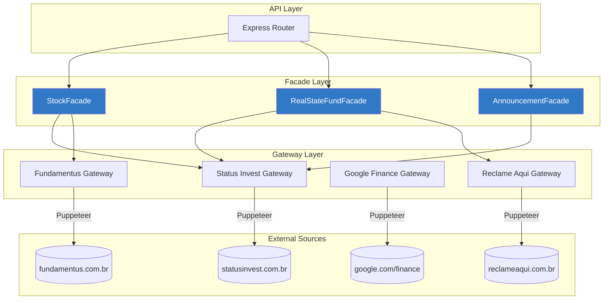

# Data Provider Module

O módulo `finances-data-provider` é um serviço de web scraping responsável por coletar dados de ativos financeiros de diversas fontes públicas como Status Invest, Fundamentus e Google Finance.

## Stack Tecnológica

| Tecnologia | Versão | Descrição |
|------------|--------|-----------|
| **Node.js** | 18+ | Runtime JavaScript |
| **TypeScript** | 4.7 | Tipagem estática |
| **Express** | 4.18 | Framework web |
| **Puppeteer** | 15.4 | Automação de browser |
| **Zod** | 3.20 | Validação de schemas |
| **Moment.js** | 2.29 | Manipulação de datas |
| **Jest** | 29.3 | Framework de testes |

## Arquitetura

O módulo segue o padrão **Facade** para abstrair a complexidade de múltiplas fontes de dados:



## Estrutura de Diretórios

```
src/
├── server.ts                     # Entry point
├── routes.ts                     # Definição de rotas
├── puppeteer-launcher.ts         # Configuração do Puppeteer
│
├── domain/
│   ├── adapters/
│   │   └── dto.ts               # Interface base DTO
│   └── types/
│       └── ...                  # Tipos TypeScript
│
├── gateways/
│   ├── google/
│   │   └── asset-current-price.ts
│   └── status_invest/
│       ├── status-invest-gateway.ts
│       └── dto/
│           └── announcement-dto.ts
│
├── stocks/
│   ├── facade/
│   │   └── stock-facade.ts
│   ├── gateway/
│   │   ├── fundamentus-stock-api.ts
│   │   ├── status-invest-stock-api.ts
│   │   └── dto/
│   │       ├── fundamentus-stock-dto.ts
│   │       └── status-invest-stock-dto.ts
│   └── service/
│       ├── fundamentus-steps-service.ts
│       ├── fundamentus-xpath-service.ts
│       ├── status-invest-steps-service.ts
│       └── status-invest-xpath-service.ts
│
├── real-state-fund/
│   ├── facade/
│   │   └── real-state-fund-facade.ts
│   ├── gateway/
│   │   ├── real-state-fund-api.ts
│   │   └── dto/
│   │       └── real-state-fund-dto.ts
│   └── services/
│       ├── real-state-fund-steps-service.ts
│       └── real-state-fund-xpath-service.ts
│
├── reclame-aqui/
│   ├── facade/
│   │   └── reclame-aqui-facade.ts
│   ├── gateway/
│   │   └── dto/
│   │       └── reclame-aqui-dto.ts
│   └── service/
│       └── ...
│
├── announcement-search-engine/
│   ├── domain/
│   │   └── ...
│   └── usecases/
│       └── get-last-announcement-usecase.ts
│
└── shared/
    ├── errors/
    │   └── base-error.ts
    ├── helpers/
    │   ├── currency-helper.ts
    │   ├── date-helper.ts
    │   └── string-helper.ts
    ├── validation/
    │   └── zod-schemas.ts
    └── web/
        └── http-status.ts
```

## Endpoints

### GET /stock/:assetCode

Retorna indicadores fundamentalistas de uma ação.

**Exemplo de requisição:**
```bash
curl http://localhost:3000/stock/PETR4
```

**Exemplo de resposta:**
```json
{
  "Preço atual": 38.45,
  "Preço mínimo (12 meses)": 29.80,
  "Preço máximo (12 meses)": 42.15,
  "Valorização (12 meses)": 15.23,
  "Tipo ação": "ON",
  "Tag along": 100,
  "Liquidez diária média (30 dias)": 1500000000,
  "Dividend yield (12 meses)": 12.5,
  "P/L": 5.2,
  "P/VP": 1.1,
  "EV/EBITDA": 3.8,
  "ROE": 25.4,
  "Margem líquida": 18.2,
  "Dívida líquida/EBITDA": 1.2,
  "Nome da empresa": "PETRÓLEO BRASILEIRO S.A. - PETROBRAS",
  "Setor de atuação": "Petróleo, Gás e Biocombustíveis",
  "Segmento de listagem": "Nível 2"
}
```

**Fontes de dados:**
- Status Invest (indicadores de mercado)
- Fundamentus (indicadores complementares)

---

### GET /real-state-fund/:assetCode

Retorna indicadores de um Fundo Imobiliário (FII).

**Exemplo de requisição:**
```bash
curl http://localhost:3000/real-state-fund/HGLG11
```

**Exemplo de resposta:**
```json
{
  "Preço atual": 156.80,
  "Preço mínimo (12 meses)": 140.20,
  "Preço máximo (12 meses)": 172.50,
  "Valor de mercado": 5200000000,
  "Liquidez diária média (30 dias)": 15000000,
  "Participação no IFIX": 2.45,
  "Número de cotistas": 450000,
  "Dividend yield (12 meses)": 9.8,
  "Rendimento mensal médio (2 anos)": 1.05,
  "P/VP": 0.95,
  "Nome do fundo": "CSHG Logística FII",
  "Administrador": "Credit Suisse Hedging-Griffo",
  "Tipo ANBIMA": "FII - Imóveis Industriais e Logísticos",
  "Segmento": "Logística",
  "Taxa de administração": "0.60% a.a.",
  "Reputação Administrador": {
    "Nota": 8.5,
    "Status": "Ótimo"
  }
}
```

**Fontes de dados:**
- Status Invest (indicadores do FII)
- Reclame Aqui (reputação do administrador)

---

### GET /announcements/:assetCode

Retorna o último comunicado de um ativo.

**Exemplo de requisição:**
```bash
curl http://localhost:3000/announcements/VALE3
```

**Exemplo de resposta:**
```json
{
  "assetCode": "VALE3",
  "title": "Dividendos - Aviso aos Acionistas",
  "releaseDate": "2024-01-15",
  "downloadUrl": "https://statusinvest.com.br/..."
}
```

---

### GET /currentPrice/:assetCode

Retorna o preço atual de um ativo via Google Finance.

**Exemplo de requisição:**
```bash
curl http://localhost:3000/currentPrice/MGLU3
```

**Exemplo de resposta:**
```json
{
  "currentPrice": 2.45
}
```

## Configuração

### .env

```env
PORT=3000
```

### Variáveis de Ambiente

| Variável | Padrão | Descrição |
|----------|--------|-----------|
| `PORT` | `3000` | Porta do servidor |

---

## Testes

### Executando

```bash
# Todos os testes
npm test

# Watch mode
npm test -- --watch

# Cobertura
npm test -- --coverage
```

### Estrutura

```
test/
├── helpers/
│   ├── currency-helper.test.ts
│   └── date-helper.test.ts
└── integration/
    └── stock-facade.test.ts
```

## Considerações de Performance

> [!WARNING]
> O web scraping com Puppeteer é lento por natureza. Considere:

1. **Cache**: Implementar cache Redis para respostas frequentes
2. **Rate Limiting**: Evitar muitas requisições simultâneas
3. **Pool de Browsers**: Reutilizar instâncias do Chromium
4. **Timeout**: Configurar timeouts adequados

## Próximos Passos

- [Web Module](./Web-Module.md) - Interface do usuário
- [Backend Module](./Backend-Module.md) - Integração com a API
- [Arquitetura](./Architecture.md) - Visão geral do sistema

---

[Voltar para Home](./Home.md)
