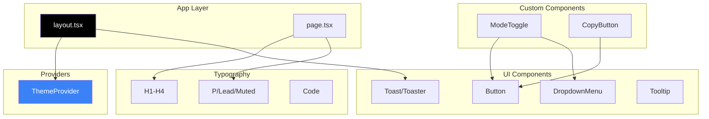

# Web Module

O módulo `finances-web` é a interface de usuário do sistema, construída com Next.js 14 e focada em uma experiência moderna com suporte a dark mode.

---

## Stack Tecnológica

| Tecnologia | Versão | Descrição |
|------------|--------|-----------|
| **Next.js** | 14.2 | Framework React com App Router |
| **React** | 18 | Biblioteca de UI |
| **TypeScript** | 5 | Tipagem estática |
| **Tailwind CSS** | 3.4 | Framework de estilos |
| **Shadcn UI** | - | Biblioteca de componentes |
| **next-themes** | 0.3 | Gerenciamento de temas |
| **Lucide React** | 0.424 | Ícones |

---

## Estrutura de Diretórios

```
finances-web/
├── public/
│   └── favicon.ico
├── src/
│   ├── app/
│   │   ├── layout.tsx          # Layout raiz
│   │   ├── page.tsx            # Página inicial
│   │   ├── loading.tsx         # Estado de loading
│   │   ├── error.tsx           # Tratamento de erros
│   │   ├── not-found.tsx       # Página 404
│   │   └── globals.css         # Estilos globais
│   ├── components/
│   │   ├── ui/                 # Componentes Shadcn
│   │   ├── typography/         # Componentes de texto
│   │   ├── providers/          # Context providers
│   │   ├── copy-button.tsx
│   │   └── mode-toggle.tsx
│   └── lib/
│       └── utils.ts            # Utilitários
├── components.json              # Configuração Shadcn
├── tailwind.config.ts          # Configuração Tailwind
├── next.config.mjs             # Configuração Next.js
└── tsconfig.json               # Configuração TypeScript
```

---

## App Router

O projeto utiliza o **App Router** do Next.js 14, que oferece:

- **Server Components** por padrão
- **File-based routing**
- **Layouts aninhados**
- **Streaming e Suspense**

### Arquivos Especiais

| Arquivo | Descrição |
|---------|-----------|
| `layout.tsx` | Layout compartilhado entre páginas |
| `page.tsx` | Componente de página |
| `loading.tsx` | UI de loading com Suspense |
| `error.tsx` | Boundary de erro |
| `not-found.tsx` | Página 404 |

### Layout Raiz

```tsx
// src/app/layout.tsx
import "./globals.css";
import { Inter } from "next/font/google";
import { ThemeProvider } from "@/components/providers/theme-provider";
import { Toaster } from "@/components/ui/toaster";

const inter = Inter({ subsets: ["latin"] });

export const metadata: Metadata = {
  title: "Finances",
  description: "Sistema de gerenciamento de finanças pessoais",
};

export default function RootLayout({ children }: { children: React.ReactNode }) {
  return (
    <html lang="pt-BR">
      <body className={inter.className}>
        <ThemeProvider
          attribute="class"
          defaultTheme="system"
          enableSystem
          disableTransitionOnChange
        >
          {children}
          <Toaster />
        </ThemeProvider>
      </body>
    </html>
  );
}
```

---

## Componentes

### UI Components (Shadcn)

Componentes de interface baseados no [Shadcn UI](https://ui.shadcn.com/):

```
components/ui/
├── button.tsx          # Botões com variantes
├── dropdown-menu.tsx   # Menus dropdown
├── toast.tsx           # Notificações toast
├── toaster.tsx         # Container de toasts
├── tooltip.tsx         # Tooltips
└── use-toast.ts        # Hook de toast
```

#### Button

```tsx
import { Button } from "@/components/ui/button";

// Variantes disponíveis
<Button variant="default">Default</Button>
<Button variant="destructive">Destructive</Button>
<Button variant="outline">Outline</Button>
<Button variant="secondary">Secondary</Button>
<Button variant="ghost">Ghost</Button>
<Button variant="link">Link</Button>

// Tamanhos
<Button size="default">Default</Button>
<Button size="sm">Small</Button>
<Button size="lg">Large</Button>
<Button size="icon"><Icon /></Button>
```

#### Toast

```tsx
import { useToast } from "@/components/ui/use-toast";

function Component() {
  const { toast } = useToast();

  return (
    <Button
      onClick={() => {
        toast({
          title: "Sucesso!",
          description: "Operação realizada com sucesso.",
        });
      }}
    >
      Mostrar Toast
    </Button>
  );
}
```

### Typography Components

Componentes semânticos para tipografia consistente:

```
components/typography/
├── h1.tsx              # Heading 1
├── h2.tsx              # Heading 2
├── h3.tsx              # Heading 3
├── h4.tsx              # Heading 4
├── p.tsx               # Parágrafo
├── lead.tsx            # Texto de destaque
├── large.tsx           # Texto grande
├── small.tsx           # Texto pequeno
├── muted.tsx           # Texto secundário
├── blockquote.tsx      # Citações
├── code/               # Blocos de código
├── list/               # Listas
└── table/              # Tabelas
```

#### Exemplo de Uso

```tsx
import { H1 } from "@/components/typography/h1";
import { P } from "@/components/typography/p";
import { Lead } from "@/components/typography/lead";

export default function Page() {
  return (
    <main>
      <H1>Bem-vindo ao Finances</H1>
      <Lead>Gerencie suas finanças de forma inteligente</Lead>
      <P>
        Acompanhe seus investimentos, transações e receba
        notificações de comunicados importantes.
      </P>
    </main>
  );
}
```

### Theme Provider

Gerenciamento de tema dark/light com `next-themes`:

```tsx
// components/providers/theme-provider.tsx
"use client";

import { ThemeProvider as NextThemesProvider } from "next-themes";

export function ThemeProvider({ children, ...props }) {
  return <NextThemesProvider {...props}>{children}</NextThemesProvider>;
}
```

### Mode Toggle

Botão para alternar entre temas:

```tsx
// components/mode-toggle.tsx
"use client";

import { useTheme } from "next-themes";
import { Moon, Sun } from "lucide-react";
import { Button } from "@/components/ui/button";
import {
  DropdownMenu,
  DropdownMenuContent,
  DropdownMenuItem,
  DropdownMenuTrigger,
} from "@/components/ui/dropdown-menu";

export function ModeToggle() {
  const { setTheme } = useTheme();

  return (
    <DropdownMenu>
      <DropdownMenuTrigger asChild>
        <Button variant="outline" size="icon">
          <Sun className="h-[1.2rem] w-[1.2rem] rotate-0 scale-100 dark:-rotate-90 dark:scale-0" />
          <Moon className="absolute h-[1.2rem] w-[1.2rem] rotate-90 scale-0 dark:rotate-0 dark:scale-100" />
          <span className="sr-only">Toggle theme</span>
        </Button>
      </DropdownMenuTrigger>
      <DropdownMenuContent align="end">
        <DropdownMenuItem onClick={() => setTheme("light")}>
          Light
        </DropdownMenuItem>
        <DropdownMenuItem onClick={() => setTheme("dark")}>
          Dark
        </DropdownMenuItem>
        <DropdownMenuItem onClick={() => setTheme("system")}>
          System
        </DropdownMenuItem>
      </DropdownMenuContent>
    </DropdownMenu>
  );
}
```

---

## Estilização

### Tailwind CSS

Configuração personalizada em `tailwind.config.ts`:

```typescript
import type { Config } from "tailwindcss";

const config: Config = {
  darkMode: ["class"],
  content: [
    "./src/**/*.{ts,tsx}",
  ],
  theme: {
    extend: {
      colors: {
        border: "hsl(var(--border))",
        background: "hsl(var(--background))",
        foreground: "hsl(var(--foreground))",
        primary: {
          DEFAULT: "hsl(var(--primary))",
          foreground: "hsl(var(--primary-foreground))",
        },
        // ... outras cores
      },
      borderRadius: {
        lg: "var(--radius)",
        md: "calc(var(--radius) - 2px)",
        sm: "calc(var(--radius) - 4px)",
      },
    },
  },
  plugins: [require("tailwindcss-animate")],
};

export default config;
```

### CSS Variables

O sistema de cores utiliza variáveis CSS para suportar dark mode:

```css
/* globals.css */
@layer base {
  :root {
    --background: 0 0% 100%;
    --foreground: 222.2 84% 4.9%;
    --primary: 222.2 47.4% 11.2%;
    --primary-foreground: 210 40% 98%;
    /* ... */
  }

  .dark {
    --background: 222.2 84% 4.9%;
    --foreground: 210 40% 98%;
    --primary: 210 40% 98%;
    --primary-foreground: 222.2 47.4% 11.2%;
    /* ... */
  }
}
```

---

## Utilitários

### cn() - Class Names

Função para combinar classes Tailwind:

```typescript
// lib/utils.ts
import { clsx, type ClassValue } from "clsx";
import { twMerge } from "tailwind-merge";

export function cn(...inputs: ClassValue[]) {
  return twMerge(clsx(inputs));
}
```

**Uso:**

```tsx
<div className={cn(
  "base-class",
  isActive && "active-class",
  variant === "primary" && "primary-variant"
)}>
```

---

## Configuração Shadcn

O arquivo `components.json` configura os componentes Shadcn:

```json
{
  "$schema": "https://ui.shadcn.com/schema.json",
  "style": "default",
  "rsc": true,
  "tsx": true,
  "tailwind": {
    "config": "tailwind.config.ts",
    "css": "src/app/globals.css",
    "baseColor": "slate",
    "cssVariables": true
  },
  "aliases": {
    "components": "@/components",
    "utils": "@/lib/utils"
  }
}
```

### Adicionando Novos Componentes

```bash
# Instalar um componente Shadcn
npx shadcn-ui@latest add button
npx shadcn-ui@latest add dialog
npx shadcn-ui@latest add form
```

---

## Scripts Disponíveis

| Script | Comando | Descrição |
|--------|---------|-----------|
| `dev` | `next dev` | Inicia em modo desenvolvimento |
| `build` | `next build` | Build de produção |
| `start` | `next start` | Inicia build de produção |
| `lint` | `next lint` | Executa ESLint |

```bash
# Desenvolvimento
npm run dev

# Build de produção
npm run build
npm start

# Linting
npm run lint
```

---

## Status do Desenvolvimento

> [!NOTE]
> O módulo web está em desenvolvimento ativo. As funcionalidades abaixo estão planejadas:

### Implementado

- [x] Setup inicial Next.js 14
- [x] Configuração Tailwind CSS
- [x] Sistema de temas (dark/light)
- [x] Componentes base Shadcn UI
- [x] Componentes de tipografia
- [x] Toast notifications

### Em Desenvolvimento

- [ ] Dashboard principal
- [ ] Listagem de portfólio
- [ ] Gráficos de performance
- [ ] Página de transações
- [ ] Integração com backend

### Planejado

- [ ] Autenticação de usuários
- [ ] PWA support
- [ ] Notificações push
- [ ] Exportação de relatórios

---

## Diagrama de Componentes



---

## Próximos Passos

- [Backend Module](./Backend-Module.md) - API que alimenta a interface
- [Data Provider Module](./Data-Provider-Module.md) - Origem dos dados de ativos
- [Arquitetura](./Architecture.md) - Visão geral do sistema

---

[Voltar para Home](./Home.md)
